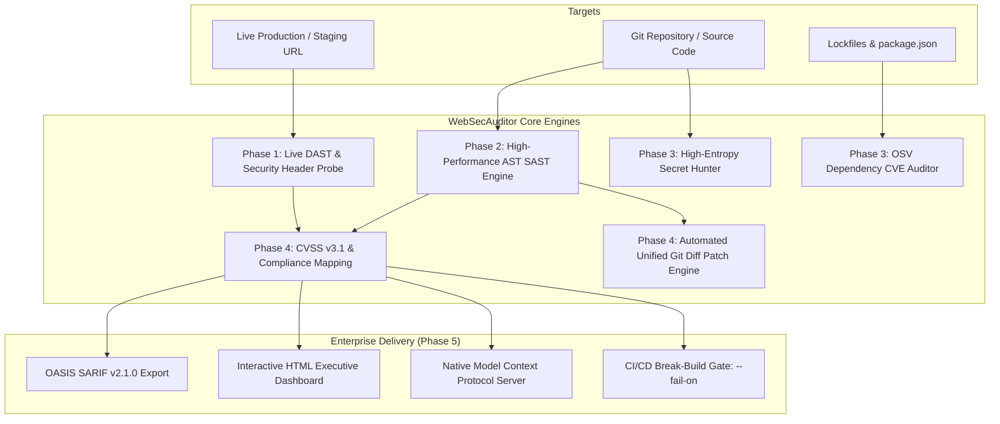

<div align="center">

# 🛡️ WebSecAuditor (`web-sec-auditor`)

**Enterprise-Grade AI Web Cybersecurity & Vulnerability Auditor for Web Applications, APIs, and Repositories**

[](https://opensource.org/licenses/MIT)
[](https://www.typescriptlang.org/)
[](https://nodejs.org/)
[](https://biomejs.dev)
[](https://owasp.org/www-project-top-ten/)
[](https://docs.oasis-open.org/sarif/sarif/v2.1.0/sarif-v2.1.0.html)
[](https://modelcontextprotocol.io/)

*Unified DAST + SAST + Secret Hunter + SCA + Auto-Patch engine with OASIS SARIF v2.1.0 reporting, interactive HTML executive dashboards, and native Model Context Protocol (MCP) server support.*

</div>

---

## ⚡ Unified Multi-Vector Cybersecurity Architecture

`web-sec-auditor` consolidates multi-stage vulnerability discovery, compliance auditing, automated patching, and CI/CD policy enforcement into a single zero-config binary:



---

## 🚀 Key Capabilities

### 📄 OASIS SARIF v2.1.0 & HTML Dashboards (Phase 5)
- 📊 **Standardized SARIF v2.1.0 Exporter**:
  - Emits schema-compliant SARIF logs (`--sarif results.sarif`) for automatic ingestion into:
    - **GitHub Advanced Security** Code Scanning (`github/codeql-action/upload-sarif`).
    - **GitLab** SAST / Dependency Scanning tabs.
    - **VS Code & JetBrains** SARIF Viewer extensions.
- 🎨 **Self-Contained Executive HTML Dashboard**:
  - Generates zero-dependency interactive HTML security reports (`--html report.html`) with KPI summary cards, CVSS distribution, compliance readiness scores, and collapsible unified git diff patch previews.

### 🤖 Universal Model Context Protocol (MCP) Server (Phase 5)
- Seamlessly connects AI coding assistants (**Cursor, Claude Desktop, Antigravity, Windsurf**) to your security auditor over standard stdio:
  1. `audit_url`: DAST probe for live endpoints and HTTP security headers.
  2. `audit_code`: SAST scan across repositories for injection and crypto flaws.
  3. `hunt_secrets`: Deep credential and high-entropy secret discovery.
  4. `audit_dependencies`: SCA check against the live OSV advisory database.
  5. `generate_patch`: Generates context-aware unified git diff auto-patches.

### 🚨 CI/CD Break-Build Gate (Phase 5)
- Automated quality gate flag: `--fail-on <CRITICAL|HIGH|MEDIUM|LOW>`.
- Halts build pipelines with exit code `1` if issues meet or exceed the specified severity threshold.
- Ready-to-use GitHub Action workflow (`.github/workflows/security-audit.yml`).

### 🛠️ Automated Code Patching & Git Diffs (Phase 4)
- Generates defensive code transformations:
  - **SQL Injection**: Converts raw query string concatenation into parameterized queries (`$1, $2`).
  - **Command Injection**: Converts `child_process.exec()` into safe `child_process.execFile()`.
  - **Path Traversal**: Confinies file reads using `path.basename()` and `path.resolve()`.
  - **DOM-XSS**: Replaces `.innerHTML = ...` with `.textContent = ...`.
  - **Disabled TLS**: Enforces `rejectUnauthorized: true`.
  - **Secret Fallbacks**: Replaces hardcoded strings with explicit environment validation checks.
- Direct patching: `web-sec-auditor patch <file> --line <num> --rule <ruleId>` (supports `--dry-run`).

### 📊 CVSS v3.1 Scoring & Compliance Mapping (Phase 4)
- **Official FIRST CVSS v3.1 Math**: Computes Base Score (0.0 to 10.0), Exploitability, Impact, and vector strings.
- **Compliance Mapping**:
  - **OWASP Top 10 (2021)**: `A01` to `A10`.
  - **PCI-DSS v4.0**: Requirements `6.2.4`, `6.4.3`, `8.3.1`, `4.1.2`.
  - **SOC 2 Type II**: Trust Services Criteria `CC6.1`, `CC6.6`, `CC7.1`.
  - **CWE Top 25**: Official rank indices (`CWE-89` #3, `CWE-79` #2, `CWE-78` #5, `CWE-22` #8).

### 🔑 High-Entropy Secret Hunter (Phase 3)
- Shannon entropy scoring \( H(S) \) with automatic masking in reports (`AKIA**************LE`).
- Detects AWS, GCP, OpenAI, Anthropic Claude, Stripe, GitHub, Slack webhooks, database URIs, and private keys.
- Scans `git log -p` commit history for deleted/historical secrets.

### 📦 Software Composition Analysis (Phase 3: SCA via OSV)
- Batch queries Open Source Vulnerability (OSV) API (`https://api.osv.dev/v1/querybatch`) for npm dependencies.
- Extracts exact patched versions (`>= 4.17.21`) and links directly to official advisories.

### 🔍 Static Application Security Testing (Phase 2: SAST)
- Multi-language AST analyzer for TypeScript, JavaScript, Python, and Go.
- Flags SQLi, Command Injection, Path Traversal, DOM-XSS, Eval, weak hashes (MD5, SHA-1), JWT none algorithm, and SSRF.

### 🌐 Live Dynamic Testing (Phase 1: DAST)
- HTTP security header probe (CSP, HSTS, XFO, XCTO, Referrer, Permissions).
- Cookie hygiene inspector (`Secure`, `HttpOnly`, `SameSite`).
- CORS policy and wildcard credential reflection analyzer.
- Transport & TLS certificate validity, expiration, and redirect chain checker.
- Deterministic 0–100 health scoring and letter grades (`A+` to `F`).

---

## 📦 Installation & CLI Usage

### 1. Unified Multi-Vector Audit
```bash
# Run full audit on repository and export SARIF + HTML with CI/CD gate
npx @ritualdev-lab/web-sec-auditor audit . \
  --sarif results.sarif \
  --html report.html \
  --fail-on HIGH

# Run audit on a live URL
npx @ritualdev-lab/web-sec-auditor audit https://example.com --html report.html
```

### 2. Specialized Scans
```bash
# SAST scan with unified git diff auto-patch previews
npx @ritualdev-lab/web-sec-auditor scan-code ./src --threshold HIGH --diff

# Apply automated defensive code patch to vulnerable line
npx @ritualdev-lab/web-sec-auditor patch ./src/user.ts --line 42 --rule SEC-INJ-SQLI

# Deep scan git commit diff history for exposed credentials
npx @ritualdev-lab/web-sec-auditor scan-secrets . --git-history

# Audit npm dependencies against OSV advisory database
npx @ritualdev-lab/web-sec-auditor scan-deps . --dev
```

### 3. Start Model Context Protocol (MCP) Server
```bash
npx @ritualdev-lab/web-sec-auditor mcp
```

---

## 🤖 Configuring MCP in AI Coding Assistants

### Cursor (`~/.cursor/mcp.json`)
```json
{
  "mcpServers": {
    "web-sec-auditor": {
      "command": "npx",
      "args": ["-y", "@ritualdev-lab/web-sec-auditor", "mcp"]
    }
  }
}
```

### Claude Desktop (`claude_desktop_config.json`)
```json
{
  "mcpServers": {
    "web-sec-auditor": {
      "command": "npx",
      "args": ["-y", "@ritualdev-lab/web-sec-auditor", "mcp"]
    }
  }
}
```

---

## 🔄 GitHub Actions CI/CD Integration

Add `.github/workflows/security-audit.yml`:

```yaml
name: Security Audit Gate
on: [push, pull_request]

jobs:
  audit:
    runs-on: ubuntu-latest
    permissions:
      contents: read
      security-events: write
    steps:
      - uses: actions/checkout@v4
        with:
          fetch-depth: 0

      - uses: actions/setup-node@v4
        with:
          node-version: 22

      - run: npx -y @ritualdev-lab/web-sec-auditor audit . --sarif results.sarif --html report.html --fail-on HIGH

      - name: Upload SARIF to GitHub Security Tab
        if: always()
        uses: github/codeql-action/upload-sarif@v3
        with:
          sarif_file: results.sarif

      - name: Upload HTML Executive Report
        if: always()
        uses: actions/upload-artifact@v4
        with:
          name: security-dashboard
          path: report.html
```

---

## 🗺️ Project Roadmap & Status

- [x] **Phase 1: Live DAST Probe, Transport Security & Network Hygiene** (Completed ✅)
- [x] **Phase 2: High-Performance SAST Engine & OWASP Top 10 Ruleset** (Completed ✅)
- [x] **Phase 3: High-Entropy Secret Hunter & SCA Dependency Auditor** (Completed ✅)
- [x] **Phase 4: AI Exploit Verification, CVSS v3.1 Scoring & Auto-Patch Engine** (Completed ✅)
- [x] **Phase 5: Enterprise Reporting, SARIF v2.1.0, MCP Protocol & CI/CD Action** (Completed ✅)

---

## 📄 License
MIT © [RitualDev Lab](https://github.com/RitualDev-Lab)
